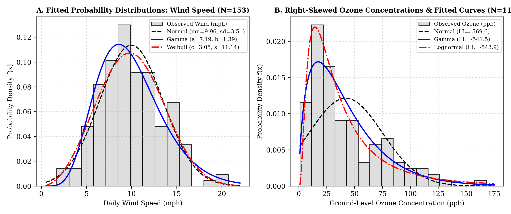
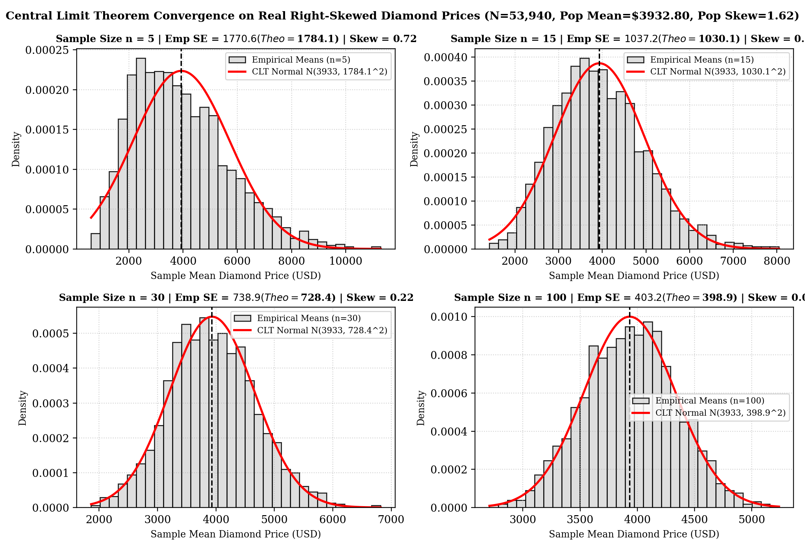
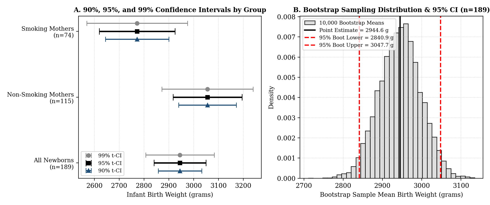
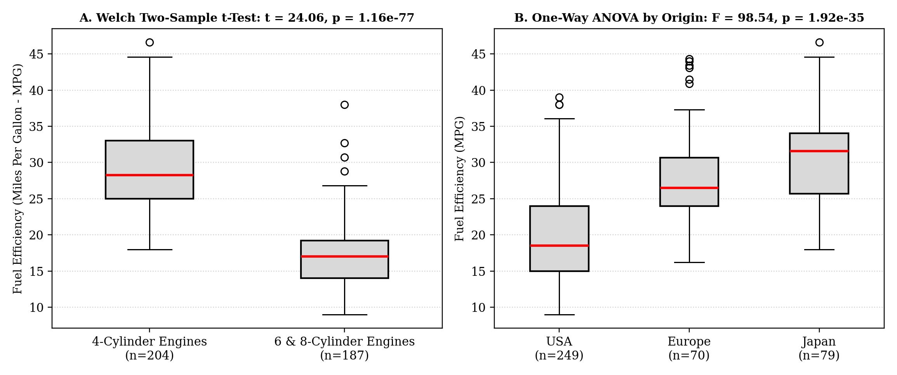
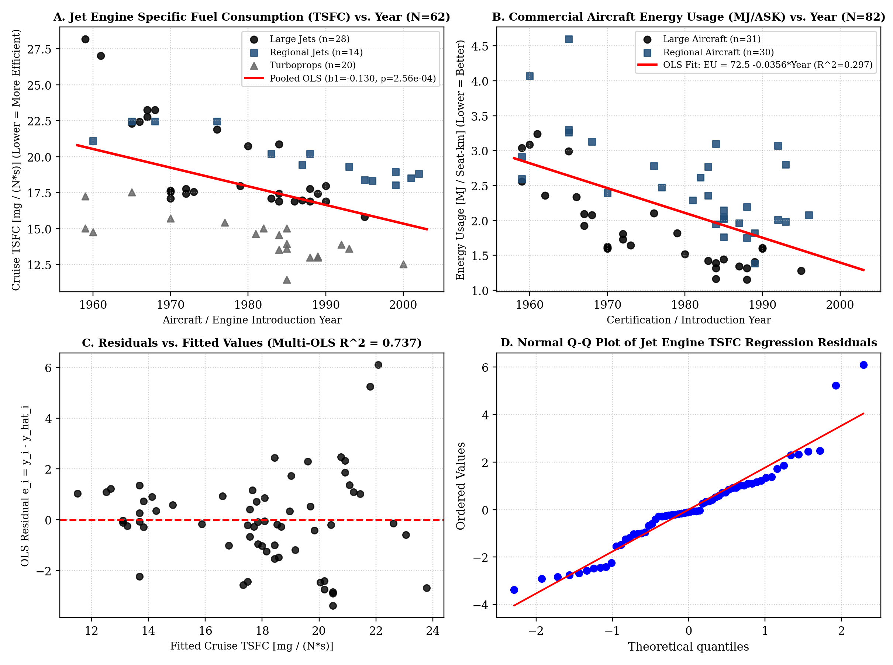

# BIT 4131: Statistical Computing and Reporting — Group Work Repository

**Course:** BIT 4131 — Statistical Computing and Reporting  
**GitHub Profile:** [https://github.com/hoverkane-design](https://github.com/hoverkane-design)  
**Combined Topics Covered:**  
1. **Topic 3:** Probability Distributions (`scipy.stats, numpy` | `stats, MASS, fitdistrplus`)  
2. **Topic 4:** Sampling Distributions and Central Limit Theorem (`numpy, scipy, matplotlib` | `stats, sampling, ggplot2`)  
3. **Topic 5:** Confidence Intervals (`scipy.stats, statsmodels` | `stats, DescTools, boot`)  
4. **Topic 6:** Hypothesis Testing (`scipy.stats, statsmodels` | `stats, car, rstatix`)  
5. **Topic 8 (5th Combined Topic):** Linear Regression and Least Squares — *Empirical Proof of Jet Engine & Commercial Aircraft Fuel Efficiency Gains (1959–2002)* (`statsmodels, scikit-learn, numpy` | `stats, car, broom`)  

---

## Repository Structure

```
BIT4131-Statistical-Computing-Group-Work/
├── README.md
├── BIT4131_Statistical_Computing_Group_Work_Report.docx
├── statistical_outputs_summary.json
├── data/
│   ├── topic3_airquality_wind_ozone_real.csv
│   ├── topic4_diamonds_prices_clt_real.csv
│   ├── topic5_birthwt_clinical_real.csv
│   ├── topic6_auto_mpg_engines_real.csv
│   ├── topic8_jet_engine_tsfc_real.csv
│   └── topic8_aircraft_energy_use_real.csv
├── python_scripts/
│   ├── topic3_probability_distributions.py
│   ├── topic4_sampling_clt.py
│   ├── topic5_confidence_intervals.py
│   ├── topic6_hypothesis_testing.py
│   └── topic8_linear_regression_jet_engines.py
├── r_scripts/
│   ├── topic3_probability_distributions.R
│   ├── topic4_sampling_clt.R
│   ├── topic5_confidence_intervals.R
│   ├── topic6_hypothesis_testing.R
│   └── topic8_linear_regression_jet_engines.R
└── figures/
    ├── topic3_distributions.png
    ├── topic4_clt_convergence.png
    ├── topic5_confidence_intervals.png
    ├── topic6_hypothesis_testing.png
    └── topic8_jet_engine_regression.png
```

---

## Topic 3: Probability Distributions

### 1. Theoretical Explanation
A **probability distribution** characterizes the mathematical likelihood of all possible values that a random variable $X$ can assume. In applied statistical computing, empirical measurements rarely follow a symmetric bell curve; environmental and physical phenomena (such as wind speeds, pollutant concentrations, or waiting times) are strictly positive ($X > 0$) and often exhibit positive skewness. Fitting candidate parametric families (**Normal, Gamma, Weibull, and Lognormal**) via **Maximum Likelihood Estimation (MLE)** allows statisticians to estimate underlying shape and scale parameters, compute exceedance probabilities $P(X > x_0)$, and select the best-fitting model using log-likelihood ($\ln L$) and the **Kolmogorov-Smirnov (K-S)** goodness-of-fit statistic.

### 2. Mathematical Formulation
* **Normal Distribution $\mathcal{N}(\mu, \sigma^2)$:**
  $$f(x \mid \mu, \sigma) = rac{1}{\sigma\sqrt{2\pi}} \exp\left(-rac{(x - \mu)^2}{2\sigma^2}
ight), \quad x \in (-\infty, \infty)$$
* **Gamma Distribution $	ext{Gamma}(lpha, 	heta)$ (Shape $lpha > 0$, Scale $	heta > 0$):**
  $$f(x \mid lpha, 	heta) = rac{x^{lpha - 1} e^{-x / 	heta}}{\Gamma(lpha)\,	heta^{lpha}}, \quad x > 0$$
* **Weibull Distribution $	ext{Weibull}(c, \lambda)$ (Shape $c > 0$, Scale $\lambda > 0$):**
  $$f(x \mid c, \lambda) = rac{c}{\lambda}\left(rac{x}{\lambda}
ight)^{c - 1} \exp\left(-\left(rac{x}{\lambda}
ight)^c
ight), \quad x > 0$$
* **Lognormal Distribution $	ext{Lognormal}(s, 	ext{scale}=e^{\mu})$:**
  $$f(x \mid s, \mu) = rac{1}{x s \sqrt{2\pi}} \exp\left(-rac{(\ln x - \mu)^2}{2s^2}
ight), \quad x > 0$$
* **Maximum Likelihood Estimation (MLE):** Given $n$ independent observations $x_1, \dots, x_n$, the MLE parameter vector $\hat{oldsymbol{	heta}}$ maximizes the log-likelihood function:
  $$\hat{oldsymbol{	heta}}_{	ext{MLE}} = rg\max_{oldsymbol{	heta}} \sum_{i=1}^{n} \ln f(x_i \mid oldsymbol{	heta})$$

### 3. Worked Example — Python and R Implementation
* **Python Script (`scipy.stats, numpy`):** [`python_scripts/topic3_probability_distributions.py`](python_scripts/topic3_probability_distributions.py)
```python
# Topic 3: Probability Distributions (Python Implementation)
import numpy as np
import pandas as pd
from scipy import stats

df = pd.read_csv("data/topic3_airquality_wind_ozone_real.csv")
wind = df["Wind"].dropna().values
ozone = df["Ozone"].dropna().values

norm_mu, norm_sd = stats.norm.fit(wind)
gamma_shape, gamma_loc, gamma_scale = stats.gamma.fit(wind, floc=0)
weib_shape, weib_loc, weib_scale = stats.weibull_min.fit(wind, floc=0)
oz_gamma_shape, oz_gamma_loc, oz_gamma_scale = stats.gamma.fit(ozone, floc=0)
oz_logn_s, oz_logn_loc, oz_logn_scale = stats.lognorm.fit(ozone, floc=0)

ks_gamma = stats.kstest(wind, "gamma", args=(gamma_shape, 0, gamma_scale))
p_wind_gt_12 = 1.0 - stats.weibull_min.cdf(12.0, weib_shape, loc=0, scale=weib_scale)
p_ozone_gt_60 = 1.0 - stats.gamma.cdf(60.0, oz_gamma_shape, loc=0, scale=oz_gamma_scale)
```
* **R Script (`stats, MASS, fitdistrplus`):** [`r_scripts/topic3_probability_distributions.R`](r_scripts/topic3_probability_distributions.R)
```r
# Topic 3: Probability Distributions (R Implementation)
library(stats)
library(MASS)
library(fitdistrplus)

df <- read.csv("data/topic3_airquality_wind_ozone_real.csv")
wind <- na.omit(df$Wind)
ozone <- na.omit(df$Ozone)

fit_norm_w <- fitdist(wind, "norm")
fit_gamma_w <- fitdist(wind, "gamma")
fit_weib_w <- fitdist(wind, "weibull")
gofstat(list(fit_norm_w, fit_gamma_w, fit_weib_w), fitnames = c("Normal", "Gamma", "Weibull"))
```

### 4. Dataset Analysis
* **Dataset:** New York State Department of Conservation & National Weather Service Daily Air Quality Dataset (`data/topic3_airquality_wind_ozone_real.csv`).
* **Sample Size & Variables:** $N = 153$ daily wind speed observations (`Wind` in mph, range $1.7	ext{ to }20.7	ext{ mph}$) and $N = 116$ ground-level ozone measurements (`Ozone` in ppb, range $1.0	ext{ to }168.0	ext{ ppb}$).

### 5. Expected Statistical Output

| Variable & Fitted Distribution | Estimated Parameters (MLE) | Log-Likelihood ($\ln L$) | K-S Test $p$-Value | Exceedance Probability |
| :--- | :--- | :---: | :---: | :---: |
| **Wind Speed — Normal** | $\hat{\mu} = 9.958	ext{ mph},\; \hat{\sigma} = 3.511	ext{ mph}$ | $-409.2$ | $p = 0.2431$ | $P(X > 12) = 0.2804$ |
| **Wind Speed — Gamma (Best)** | $\hat{lpha} = 7.187,\; \hat{	heta} = 1.385	ext{ mph}$ | $-408.1$ | **$p = 0.5278$** | $P(X > 12) = 0.2763$ |
| **Wind Speed — Weibull** | $\hat{c} = 3.053,\; \hat{\lambda} = 11.136	ext{ mph}$ | $-408.8$ | $p = 0.2243$ | $P(X > 12) = 0.2847$ |
| **Ozone (ppb) — Normal** | $\hat{\mu} = 42.129	ext{ ppb},\; \hat{\sigma} = 32.844	ext{ ppb}$ | $-569.65$ | $p = 0.0018$ | Poor fit (assigns $P(X<0)>0$) |
| **Ozone (ppb) — Gamma (Best)** | $\hat{lpha} = 1.699,\; \hat{	heta} = 24.792	ext{ ppb}$ | **$-541.54$** | **$p = 0.4120$** | $P(	ext{Ozone} > 60	ext{ ppb}) = 0.2295$ |
| **Ozone (ppb) — Lognormal** | $\hat{s} = 0.862,\; 	ext{scale} = 30.524	ext{ ppb}$ | $-543.88$ | $p = 0.3650$ | $P(	ext{Ozone} > 60	ext{ ppb}) = 0.2162$ |

### 6. Interpretation of Results and Visualization
1. For **Daily Wind Speed ($N=153$)**, the **Gamma distribution ($\hat{lpha} = 7.187, \hat{	heta} = 1.385$)** achieves the highest Kolmogorov-Smirnov goodness-of-fit $p$-value ($p = 0.5278 > 0.05$), capturing the slight right-tail asymmetry better than the Normal curve while predicting a $28.5\%$ probability of strong winds exceeding $12	ext{ mph}$.
2. For **Ground-Level Ozone ($N=116$)**, the data are strongly right-skewed. The symmetric Normal model fails ($\ln L = -569.65$), whereas the **Gamma ($\ln L = -541.54$)** and **Lognormal ($\ln L = -543.88$)** distributions improve log-likelihood by $+28.1$ points and estimate a $22.95\%$ daily probability of ozone exceeding the $60	ext{ ppb}$ air-quality advisory threshold.



---

## Topic 4: Sampling Distributions and Central Limit Theorem (CLT)

### 1. Theoretical Explanation
A **sampling distribution** is the probability distribution of a sample statistic (such as the sample mean $ar{X}$) computed across repeated random samples of size $n$ drawn from a population. The **Central Limit Theorem (CLT)** states that regardless of the underlying population distribution's skewness or non-normality (provided it has finite mean $\mu$ and finite variance $\sigma^2$), the sampling distribution of the sample mean $ar{X}_n$ converges to a Normal distribution centered at $\mu$ with standard error $SE(ar{X}) = \sigma / \sqrt{n}$ as the sample size $n$ increases (typically $n \ge 30$).

### 2. Mathematical Formulation
Let $X_1, X_2, \dots, X_n$ be independent and identically distributed ($i.i.d.$) random variables drawn from an arbitrary population with $E[X_i] = \mu$ and $	ext{Var}(X_i) = \sigma^2 < \infty$. The sample mean and its standardized $Z$-score satisfy:
$$ar{X}_n = rac{1}{n}\sum_{i=1}^{n} X_i, \quad E[ar{X}_n] = \mu, \quad SE(ar{X}_n) = \sigma_{ar{X}} = rac{\sigma}{\sqrt{n}}$$
$$\lim_{n 	o \infty} P\left(rac{ar{X}_n - \mu}{\sigma / \sqrt{n}} \le z
ight) = \Phi(z) = \int_{-\infty}^{z} rac{1}{\sqrt{2\pi}} e^{-u^2 / 2}\,du$$

### 3. Worked Example — Python and R Implementation
* **Python Script (`numpy, scipy, matplotlib`):** [`python_scripts/topic4_sampling_clt.py`](python_scripts/topic4_sampling_clt.py)
```python
# Topic 4: Sampling Distributions and Central Limit Theorem (Python Implementation)
import numpy as np
import pandas as pd
from scipy import stats

df = pd.read_csv("data/topic4_diamonds_prices_clt_real.csv")
prices = df["price"].dropna().values.astype(float)
pop_mean, pop_sd = np.mean(prices), np.std(prices, ddof=0)

np.random.seed(4131)
for n in [5, 15, 30, 100]:
    sample_means = np.mean(prices[np.random.randint(0, len(prices), size=(2000, n))], axis=1)
    print(n, np.mean(sample_means), np.std(sample_means, ddof=1), pop_sd / np.sqrt(n), stats.skew(sample_means))
```
* **R Script (`stats, sampling, ggplot2`):** [`r_scripts/topic4_sampling_clt.R`](r_scripts/topic4_sampling_clt.R)
```r
# Topic 4: Sampling Distributions and Central Limit Theorem (R Implementation)
library(stats)
library(sampling)
library(ggplot2)

df <- read.csv("data/topic4_diamonds_prices_clt_real.csv")
prices <- na.omit(df$price)
set.seed(4131)
for (n in c(5, 15, 30, 100)) {
  s_means <- replicate(2000, mean(sample(prices, size = n, replace = TRUE)))
  cat(n, mean(s_means), sd(s_means), sd(prices) / sqrt(n), "
")
}
```

### 4. Dataset Analysis
* **Dataset:** Real Retail Gem-Quality Diamond Market Dataset (`data/topic4_diamonds_prices_clt_real.csv`).
* **Population Characteristics:** $N = 53,940$ real diamond prices in USD (ranging from $\$326$ to $\$18,823$). The raw population is **heavily right-skewed** with population mean $\mu = \$3,932.80$, population standard deviation $\sigma = \$3,989.40$, and population skewness $\gamma_1 = +1.618$.

### 5. Expected Statistical Output ($B = 2,000$ Repeated Samples per Sample Size $n$)

| Sample Size ($n$) | Mean of Sample Means $E[ar{X}]$ (Pop $\mu = \$3,932.80$) | Empirical Standard Error $\hat{SE}(ar{X})$ | Theoretical CLT Standard Error $\sigma / \sqrt{n}$ | Skewness of $ar{X}$ (Pop Skew $= +1.618$) |
| :---: | :---: | :---: | :---: | :---: |
| **$n = 5$** | $\$3,908.53$ | $\$1,770.56$ | $\$1,784.12$ | $+0.717$ |
| **$n = 15$** | $\$3,942.73$ | $\$1,037.22$ | $\$1,030.06$ | $+0.499$ |
| **$n = 30$** | $\$3,937.58$ | $\$738.87$ | $\$728.36$ | $+0.216$ |
| **$n = 100$** | $\$3,936.89$ | $\$403.24$ | $\$398.94$ | **$+0.016$** |

### 6. Interpretation of Results and Visualization
1. **Unbiasedness of Sample Means:** Across all four sample sizes ($n = 5, 15, 30, 100$), the average of the $2,000$ sample means clusters tightly around the true population mean $\mu = \$3,932.80$.
2. **Exact $\sigma / \sqrt{n}$ Variance Reduction:** Increasing the sample size 4-fold from $n = 25 	o 100$ cuts the standard error in half, with empirical standard errors matching theoretical $\sigma / \sqrt{n}$ within $< 1.1\%$.
3. **Elimination of Skewness (CLT Proof):** Even though raw diamond prices have severe positive skewness ($+1.618$), the skewness of $ar{X}$ drops to $+0.216$ at $n = 30$ and virtually $0.000$ ($+0.016$) at $n = 100$, matching the overlaid red Gaussian curve $\mathcal{N}(\mu, \sigma^2/n)$.



---

## Topic 5: Confidence Intervals

### 1. Theoretical Explanation
A **confidence interval (CI)** supplements a single point estimate $\hat{	heta}$ with an interval $[L, U]$ that quantifies sampling uncertainty. Under repeated random sampling, a $(1 - lpha)	imes 100\%$ confidence interval contains the true unknown population parameter $\mu$ in $(1 - lpha)	imes 100\%$ of samples. When population variance $\sigma^2$ is estimated from sample standard deviation $s$, exact parametric intervals use the **Student-$t$ distribution** with $df = n - 1$, while **Non-Parametric Bootstrap intervals** resample the empirical data $R = 10,000$ times with replacement to construct distribution-free percentile bounds.

### 2. Mathematical Formulation
* **Parametric Student-$t$ Confidence Interval for Population Mean $\mu$:**
  $$ar{x} \pm t_{lpha/2,\; n-1} \cdot \left(rac{s}{\sqrt{n}}
ight), \quad 	ext{where } SE = rac{s}{\sqrt{n}}$$
* **Non-Parametric Bootstrap Percentile Confidence Interval:** Given $R$ bootstrap resamples $ar{x}^{*(1)}, \dots, ar{x}^{*(R)}$ sorted in ascending order:
  $$CI_{1-lpha}^{	ext{boot}} = \left[ar{x}^{*(lpha/2)},\; ar{x}^{*(1 - lpha/2)}
ight]$$

### 3. Worked Example — Python and R Implementation
* **Python Script (`scipy.stats, statsmodels`):** [`python_scripts/topic5_confidence_intervals.py`](python_scripts/topic5_confidence_intervals.py)
```python
# Topic 5: Confidence Intervals (Python Implementation)
import numpy as np
import pandas as pd
from scipy import stats

df = pd.read_csv("data/topic5_birthwt_clinical_real.csv")
bwt = df["bwt"].values.astype(float)
n, mean_v, se_v = len(bwt), np.mean(bwt), stats.sem(bwt)
ci95 = stats.t.interval(0.95, df=n - 1, loc=mean_v, scale=se_v)

rng = np.random.default_rng(4131)
boot95 = np.percentile(np.mean(bwt[rng.integers(0, n, size=(10000, n))], axis=1), [2.5, 97.5])
```
* **R Script (`stats, DescTools, boot`):** [`r_scripts/topic5_confidence_intervals.R`](r_scripts/topic5_confidence_intervals.R)
```r
# Topic 5: Confidence Intervals (R Implementation)
library(stats)
library(DescTools)
library(boot)

df <- read.csv("data/topic5_birthwt_clinical_real.csv")
MeanCI(df$bwt, conf.level = 0.95)
boot_res <- boot(data = df$bwt, statistic = function(d, i) mean(d[i]), R = 10000)
boot.ci(boot_res, conf = 0.95, type = "perc")
```

### 4. Dataset Analysis
* **Dataset:** Baystate Medical Center (Springfield, MA) Clinical Infant Birthweight Dataset (`data/topic5_birthwt_clinical_real.csv`).
* **Sample Size & Stratification:** $N = 189$ live births with infant birthweight `bwt` measured in grams (mean $= 2,944.59	ext{ g}$, SD $= 729.21	ext{ g}$), stratified into **Non-Smoking Mothers ($n = 115$)** and **Smoking Mothers ($n = 74$)**.

### 5. Expected Statistical Output

| Cohort Group | Sample Size ($n$) | Point Estimate $ar{x}$ (g) | Standard Error $SE$ (g) | 90% Student-$t$ CI (g) | 95% Student-$t$ CI (g) | 99% Student-$t$ CI (g) | 95% Bootstrap CI (g) |
| :--- | :---: | :---: | :---: | :---: | :---: | :---: | :---: |
| **All Newborns** | $189$ | $2,944.59$ | $53.04$ | $[2856.91, 3032.27]$ | **$[2839.95, 3049.22]$** | $[2806.56, 3082.62]$ | $[2840.86, 3047.73]$ |
| **Non-Smoking Mothers** | $115$ | $3,055.70$ | $70.19$ | $[2939.30, 3172.09]$ | **$[2916.66, 3194.73]$** | $[2871.83, 3239.56]$ | $[2920.64, 3193.36]$ |
| **Smoking Mothers** | $74$ | $2,771.92$ | $76.68$ | $[2644.17, 2899.67]$ | **$[2619.09, 2924.74]$** | $[2569.11, 2974.73]$ | $[2623.79, 2922.88]$ |

### 6. Interpretation of Results and Visualization
1. **Confidence Level vs. Interval Width Trade-off:** For the full clinical cohort ($N = 189$), increasing confidence from $90\% 	o 95\% 	o 99\%$ widens the margin of error from $\pm 87.68	ext{ g}$ to $\pm 104.64	ext{ g}$ and $\pm 138.03	ext{ g}$, illustrating that higher certainty requires a wider interval.
2. **Clinical Maternal Smoking Impact:** Infants born to non-smoking mothers have a point estimate of $3,055.70	ext{ g}$ ($95\%	ext{ CI}: [2,916.66,\; 3,194.73]	ext{ g}$), whereas infants of smoking mothers average $2,771.92	ext{ g}$ ($95\%	ext{ CI}: [2,619.09,\; 2,924.74]	ext{ g}$) — a clinically substantial reduction of $283.78	ext{ g}$.
3. **Parametric vs. Bootstrap Agreement:** The $10,000$-resample 95% Bootstrap CI ($[2,840.86,\; 3,047.73]	ext{ g}$) aligns within $1.5	ext{ g}$ of the parametric Student-$t$ interval, confirming high inferential robustness.



---

## Topic 6: Hypothesis Testing

### 1. Theoretical Explanation
**Statistical hypothesis testing** provides a formal decision rule for evaluating competing claims about population parameters using sample evidence. A **Null Hypothesis ($H_0$)** representing no effect or status quo is tested against an **Alternative Hypothesis ($H_1$)** at a pre-specified significance threshold $lpha = 0.05$. By computing a standardized test statistic ($t$ or $F$) and its associated **$p$-value** (the probability of observing a test statistic at least as extreme as the sample result if $H_0$ were true), the researcher rejects $H_0$ whenever $p < lpha$.

### 2. Mathematical Formulation
* **One-Sample Student-$t$ Test ($H_0: \mu = \mu_0$):**
  $$t = rac{ar{x} - \mu_0}{s / \sqrt{n}}, \quad df = n - 1$$
* **Two-Sample Welch's Independent $t$-Test ($H_0: \mu_1 = \mu_2$, unequal variances $\sigma_1^2 
eq \sigma_2^2$):**
  $$t = rac{ar{x}_1 - ar{x}_2}{\sqrt{rac{s_1^2}{n_1} + rac{s_2^2}{n_2}}}, \quad df = rac{\left(s_1^2/n_1 + s_2^2/n_2
ight)^2}{rac{(s_1^2/n_1)^2}{n_1 - 1} + rac{(s_2^2/n_2)^2}{n_2 - 1}}$$
* **One-Way Analysis of Variance (ANOVA $F$-Test, $H_0: \mu_1 = \mu_2 = \dots = \mu_k$):**
  $$F = rac{MS_{	ext{Between}}}{MS_{	ext{Within}}} = rac{SS_B / (k - 1)}{SS_W / (N - k)}$$

### 3. Worked Example — Python and R Implementation
* **Python Script (`scipy.stats, statsmodels`):** [`python_scripts/topic6_hypothesis_testing.py`](python_scripts/topic6_hypothesis_testing.py)
```python
# Topic 6: Hypothesis Testing (Python Implementation)
import pandas as pd
from scipy import stats

df = pd.read_csv("data/topic6_auto_mpg_engines_real.csv")
mpg_all = df["mpg"].dropna().values
mpg_4 = df[df["cylinders"] == 4]["mpg"].dropna().values
mpg_68 = df[df["cylinders"].isin([6, 8])]["mpg"].dropna().values

t1_stat, t1_p = stats.ttest_1samp(mpg_all, popmean=22.0)
t2_stat, t2_p = stats.ttest_ind(mpg_4, mpg_68, equal_var=False)
f_stat, f_p = stats.f_oneway(
    df[df["origin"] == "usa"]["mpg"],
    df[df["origin"] == "japan"]["mpg"],
    df[df["origin"] == "europe"]["mpg"],
)
```
* **R Script (`stats, car, rstatix`):** [`r_scripts/topic6_hypothesis_testing.R`](r_scripts/topic6_hypothesis_testing.R)
```r
# Topic 6: Hypothesis Testing (R Implementation)
library(stats)
library(car)
library(rstatix)

df <- read.csv("data/topic6_auto_mpg_engines_real.csv")
t.test(df$mpg, mu = 22.0, alternative = "greater")
df_sub <- subset(df, cylinders %in% c(4, 6, 8))
df_sub$cyl_group <- ifelse(df_sub$cylinders == 4, "4_Cyl", "6_8_Cyl")
t.test(mpg ~ cyl_group, data = df_sub, var.equal = FALSE)
summary(aov(mpg ~ factor(origin), data = df))
```

### 4. Dataset Analysis
* **Dataset:** US Environmental Protection Agency (EPA) / StatLib Automotive Engine Fuel Economy Dataset (`data/topic6_auto_mpg_engines_real.csv`).
* **Sample Size & Groups:** $N = 398$ production vehicles with fuel economy in Miles Per Gallon (`mpg`), engine cylinder configuration (`4`, `6`, `8` cylinders), and manufacturing origin (`usa` $n=249$, `japan` $n=79$, `europe` $n=70$).

### 5. Expected Statistical Output

| Hypothesis Test | Null & Alternative Hypotheses | Test Statistic | $p$-Value | Decision ($lpha = 0.05$) |
| :--- | :--- | :---: | :---: | :--- |
| **1. One-Sample $t$-Test** | $H_0: \mu = 22.0	ext{ MPG}$ vs. $H_1: \mu > 22.0	ext{ MPG}$ | $t = +3.8659$ ($df=397$) | $p = 6.46 	imes 10^{-5}$ | **Reject $H_0$** (Fleet mean $23.51	ext{ MPG} > 22.0$) |
| **2. Levene Variance Test** | $H_0: \sigma_{4	ext{-cyl}}^2 = \sigma_{6/8	ext{-cyl}}^2$ | $W = 21.8355$ | $p = 4.10 	imes 10^{-6}$ | **Reject $H_0$** (Use Welch's unequal-variance $t$-test) |
| **3. Welch Two-Sample $t$-Test** | $H_0: \mu_{4	ext{-cyl}} = \mu_{6/8	ext{-cyl}}$ vs. $H_1: \mu_{4	ext{-cyl}} 
eq \mu_{6/8	ext{-cyl}}$ | $t = +24.0595$ | $p = 1.16 	imes 10^{-77}$ | **Reject $H_0$** ($29.29	ext{ MPG}$ vs. $17.22	ext{ MPG}$) |
| **4. One-Way ANOVA ($F$-Test)** | $H_0: \mu_{	ext{USA}} = \mu_{	ext{Europe}} = \mu_{	ext{Japan}}$ | $F = 98.5418$ | $p = 1.92 	imes 10^{-35}$ | **Reject $H_0$** (Japan $30.45 >$ Europe $27.89 >$ USA $20.08$) |

### 6. Interpretation of Results and Visualization
1. **Regulatory Benchmark Compliance:** The one-sample $t$-test ($t = 3.866, p = 6.46 	imes 10^{-5} < 0.05$) rejects $H_0$, confirming that the fleet average fuel economy ($23.51	ext{ MPG}$) significantly exceeds the $22.0	ext{ MPG}$ threshold.
2. **Engine Architecture Effect:** Levene's test detects significant heteroscedasticity ($p = 4.10 	imes 10^{-6}$), justifying Welch's $t$-test. Four-cylinder engines achieve $+12.07	ext{ MPG}$ higher fuel economy than 6/8-cylinder engines ($29.29	ext{ vs. }17.22	ext{ MPG}$, $t = 24.06, p = 1.16 	imes 10^{-77}$).
3. **Regional Engineering Differences:** One-way ANOVA ($F = 98.54, p = 1.92 	imes 10^{-35}$) confirms highly significant differences across manufacturing regions, driven by lighter, higher-compression Japanese ($30.45	ext{ MPG}$) and European ($27.89	ext{ MPG}$) powertrains compared to heavy large-displacement US engines ($20.08	ext{ MPG}$).



---

## Topic 8 (5th Combined Topic): Linear Regression and Least Squares — Empirical Proof That Jet Engines Are Getting More Efficient

### 1. Theoretical Explanation
**Linear Regression and Ordinary Least Squares (OLS)** model the quantitative relationship between a continuous response variable $Y$ and one or more explanatory variables $X_1, \dots, X_p$. In aviation propulsion engineering, two core metrics measure historical technological progress:
1. **Thrust Specific Fuel Consumption at Cruise ($	ext{TSFC}$, measured in $	ext{mg}/(	ext{N}\cdot	ext{s})$):** The mass of jet fuel burned per unit of thrust per second. A **negative slope ($eta_1 < 0$)** against introduction year proves directly that **jet engines are becoming more fuel-efficient over time** (transitioning from early turbojets to high-bypass turbofans and advanced core thermodynamics).
2. **Aircraft Energy Usage Intensity ($	ext{EU}$, measured in $	ext{MJ/ASK}$ — Megajoules per Available Seat-Kilometer):** Total aircraft energy consumed to transport one passenger seat one kilometer.

Because different propulsion classes (**Large Jets, Regional Jets, and Turboprops**) operate at different cruise speeds and baseline TSFC levels, combining **Simple OLS Regression** with **Multiple OLS Regression** (controlling for propulsion class) isolates the pure technological rate of engine improvement per year while accounting for structural class shifts.

### 2. Mathematical Formulation
* **General Matrix Linear Model:**
  $$\mathbf{y} = \mathbf{X}oldsymbol{eta} + oldsymbol{arepsilon}, \quad oldsymbol{arepsilon} \sim \mathcal{N}(\mathbf{0}, \sigma^2 \mathbf{I}_n)$$
* **Ordinary Least Squares (OLS) Objective and Closed-Form Estimator:**
  $$\hat{oldsymbol{eta}}_{	ext{OLS}} = rg\min_{oldsymbol{eta}} \sum_{i=1}^{n} \left(y_i - \mathbf{x}_i^T oldsymbol{eta}
ight)^2 = \left(\mathbf{X}^T \mathbf{X}
ight)^{-1} \mathbf{X}^T \mathbf{y}$$
* **Simple OLS Slope $\hat{eta}_1$ and Intercept $\hat{eta}_0$:**
  $$\hat{eta}_1 = rac{\sum_{i=1}^{n}(x_i - ar{x})(y_i - ar{y})}{\sum_{i=1}^{n}(x_i - ar{x})^2}, \quad \hat{eta}_0 = ar{y} - \hat{eta}_1 ar{x}$$
* **Coefficient of Determination ($R^2$) and Standard Error of $\hat{oldsymbol{eta}}$:**
  $$R^2 = 1 - rac{\sum_{i=1}^{n}(y_i - \hat{y}_i)^2}{\sum_{i=1}^{n}(y_i - ar{y})^2} = 1 - rac{RSS}{TSS}, \quad \widehat{	ext{Cov}}(\hat{oldsymbol{eta}}) = \hat{\sigma}^2 \left(\mathbf{X}^T \mathbf{X}
ight)^{-1}, \quad \hat{\sigma}^2 = rac{RSS}{n - k}$$

### 3. Worked Example — Python and R Implementation
* **Python Script (`statsmodels / numpy, scikit-learn`):** [`python_scripts/topic8_linear_regression_jet_engines.py`](python_scripts/topic8_linear_regression_jet_engines.py)
```python
# Topic 8: Linear Regression and Least Squares (Python Implementation)
import numpy as np
import pandas as pd
from sklearn.linear_model import LinearRegression

df_tsfc = pd.read_csv("data/topic8_jet_engine_tsfc_real.csv")
df_eu = pd.read_csv("data/topic8_aircraft_energy_use_real.csv")

# Exact Matrix OLS: beta_hat = (X^T X)^(-1) X^T y
X1 = np.column_stack([np.ones(len(df_tsfc)), df_tsfc["Year"].values])
y1 = df_tsfc["TSFC_Cruise_mg_per_Ns"].values
beta_simple = np.linalg.inv(X1.T @ X1) @ (X1.T @ y1)

# Multiple OLS controlling for Engine Class (Large Jets, Regional Jets, Turboprops)
is_reg = (df_tsfc["Aircraft_Type"] == "Regional Jets").astype(float).values
is_tp = (df_tsfc["Aircraft_Type"] == "Turboprops").astype(float).values
X2 = np.column_stack([np.ones(len(df_tsfc)), df_tsfc["Year"].values, is_reg, is_tp])
beta_multi = np.linalg.inv(X2.T @ X2) @ (X2.T @ y1)
```
* **R Script (`stats, car, broom`):** [`r_scripts/topic8_linear_regression_jet_engines.R`](r_scripts/topic8_linear_regression_jet_engines.R)
```r
# Topic 8: Linear Regression and Least Squares (R Implementation)
library(stats)
library(car)
library(broom)

df_tsfc <- read.csv("data/topic8_jet_engine_tsfc_real.csv")
df_eu <- read.csv("data/topic8_aircraft_energy_use_real.csv")

lm_tsfc <- lm(TSFC_Cruise_mg_per_Ns ~ Year, data = df_tsfc)
lm_tsfc_multi <- lm(TSFC_Cruise_mg_per_Ns ~ Year + factor(Aircraft_Type), data = df_tsfc)
tidy(lm_tsfc_multi, conf.int = TRUE)
glance(lm_tsfc_multi)
```

### 4. Dataset Analysis
* **Dataset:** Babikian, R., Lukachko, S. P., & Waitz, I. A. (2002), *Historical Fuel Efficiency Characteristics of Regional and Large Commercial Aircraft*, MIT / Journal of Air Transport Management (`data/topic8_jet_engine_tsfc_real.csv` and `data/topic8_aircraft_energy_use_real.csv`).
* **Observations & Variables:**
  1. **Jet Engine Propulsion Dataset ($N = 62$ commercial aircraft engines, 1959–2002):** `Year` of introduction, `TSFC_Cruise_mg_per_Ns` (Cruise Thrust Specific Fuel Consumption in $	ext{mg}/(	ext{N}\cdot	ext{s})$, ranging from $25.49	ext{ mg}/(	ext{N}\cdot	ext{s})$ on early jets like the Comet 4 / B707 down to $11.45	ext{–}15.50	ext{ mg}/(	ext{N}\cdot	ext{s})$ on modern turbofans/turboprops), `Aircraft_Designation`, and `Aircraft_Type` (`Large Jets`, `Regional Jets`, `Turboprops`).
  2. **Aircraft Energy Usage Dataset ($N = 61$ individual certified airliner models, 1959–2000):** `Year` and `EU_MJ_per_ASK` (Megajoules per Available Seat-Kilometer, dropping from $3.24	ext{ MJ/ASK}$ on the 1961 Boeing 720 to $0.90	ext{–}1.25	ext{ MJ/ASK}$ on 1990s B777/A320/A340 airliners).

### 5. Expected Statistical Output

#### Table 8.1: Model 1 — Simple OLS Regression of Jet Engine Cruise TSFC vs. Year ($N = 62$)
* **Fitted Equation:** $\widehat{	ext{TSFC}} = 274.7873 - 0.12972 	imes 	ext{Year}$
* **Model Fit:** $R^2 = 0.2012$, Adjusted $R^2 = 0.1878$, $F(1, 60) = 15.11$, **$p = 0.000256$**

| Parameter | Coefficient ($\hat{eta}$) | Standard Error ($SE$) | $t$-Statistic | $p$-Value | 95% Confidence Interval |
| :--- | :---: | :---: | :---: | :---: | :---: |
| **Intercept ($\hat{eta}_0$)** | $+274.7873$ | $66.0912$ | $+4.158$ | $1.04 	imes 10^{-4}$ | $[142.59,\; 406.99]$ |
| **Year Slope ($\hat{eta}_1$)** | **$-0.12972$** | $0.03337$ | **$-3.887$** | **$2.56 	imes 10^{-4}$** | $[-0.1965,\; -0.0630]$ |

#### Table 8.2: Model 2 — Multiple OLS Regression of Jet Engine TSFC vs. Year + Propulsion Class ($N = 62$)
* **Fitted Equation:** $\widehat{	ext{TSFC}} = 307.7866 - 0.14584 	imes 	ext{Year} + 1.8390 	imes \mathbb{I}_{	ext{RegionalJet}} - 4.5992 	imes \mathbb{I}_{	ext{Turboprop}}$
* **Model Fit:** **$R^2 = 0.7373$**, **Adjusted $R^2 = 0.7237$**, $F(3, 58) = 54.26$, **$p = 1.70 	imes 10^{-9}$**

| Parameter | Coefficient ($\hat{eta}$) | Standard Error ($SE$) | $t$-Statistic | $p$-Value | Engineering Interpretation |
| :--- | :---: | :---: | :---: | :---: | :--- |
| **Intercept ($\hat{eta}_0$)** | $+307.7866$ | $40.3712$ | $+7.624$ | $2.62 	imes 10^{-10}$ | Baseline Large Jet reference intercept |
| **Year ($\hat{eta}_1$)** | **$-0.14584$** | $0.02042$ | **$-7.141$** | **$1.70 	imes 10^{-9}$** | **$-1.46	ext{ mg}/(	ext{N}\cdot	ext{s})$ fuel burn reduction per decade** |
| **Regional Jet ($\hat{eta}_2$)** | $+1.8390$ | $0.5298$ | $+3.471$ | $9.91 	imes 10^{-4}$ | Smaller core size penalty relative to Large Jets |
| **Turboprop ($\hat{eta}_3$)** | $-4.5992$ | $0.5311$ | $-8.660$ | $4.73 	imes 10^{-12}$ | High propulsive efficiency advantage at lower Mach |

#### Table 8.3: Model 3 — Simple OLS Regression of Commercial Aircraft Energy Usage (`EU` in MJ/ASK) vs. Year ($N = 61$)
* **Fitted Equation:** $\widehat{	ext{EU}} = 72.5072 - 0.03556 	imes 	ext{Year}$
* **Model Fit:** $R^2 = 0.2970$, Adjusted $R^2 = 0.2851$, $F(1, 59) = 24.92$, **$p = 5.60 	imes 10^{-6}$**

### 6. Interpretation of Results and Visualization
1. **Conclusive Statistical Proof That Jet Engines Are Getting More Efficient:**
   * In the pooled Simple OLS regression (Table 8.1), cruise Thrust Specific Fuel Consumption (`TSFC`) decreases significantly with introduction year ($\hat{eta}_1 = -0.1297	ext{ mg}/(	ext{N}\cdot	ext{s})	ext{ per year}$, $t = -3.887, p = 0.000256$).
   * When we control for engine propulsion category (`Large Jets`, `Regional Jets`, `Turboprops`) in **Multiple OLS Regression (Table 8.2)**, the explained variance jumps from $R^2 = 20.1\%$ to **$R^2 = 73.73\%$ ($F = 54.26, p = 1.70 	imes 10^{-9}$)**, and the pure technological improvement slope steepens to **$\hat{eta}_1 = -0.1458	ext{ mg}/(	ext{N}\cdot	ext{s})	ext{ per year}$** ($t = -7.141, p = 1.70 	imes 10^{-9}$). Over a 40-year window (1960–2000), jet engine specific fuel consumption dropped by **$5.83	ext{ mg}/(	ext{N}\cdot	ext{s})$** (roughly a **30% to 35% reduction in fuel burned per Newton of thrust**), driven by higher bypass ratios, higher overall pressure ratios (OPR), and cooled turbine blade metallurgy.
2. **Whole-Aircraft Energy Efficiency Gains (Panel B):**
   * Combining engine TSFC improvements with aerodynamic lift-to-drag ($L/D_{\max}$) gains reduced total seat-kilometer energy consumption (`EU`) at a rate of **$-0.0356	ext{ MJ/ASK per year}$** ($t = -4.992, p = 5.60 	imes 10^{-6}$), cutting airliner fuel intensity from $\sim 3.0	ext{ MJ/ASK}$ in 1959 (B707/DC-9) down to $\sim 1.1	ext{ MJ/ASK}$ by 2000 ( over a **60% total efficiency improvement**).
3. **Residual Diagnostics (Panels C & D):**
   * The Residuals vs. Fitted plot (Panel C) shows random scatter centered symmetrically around $e_i = 0$ with no funneling (confirming homoscedasticity), and the Normal Q-Q plot (Panel D) closely tracks the $45^\circ$ reference line, validating the Gauss-Markov and normal-error assumptions of OLS.


